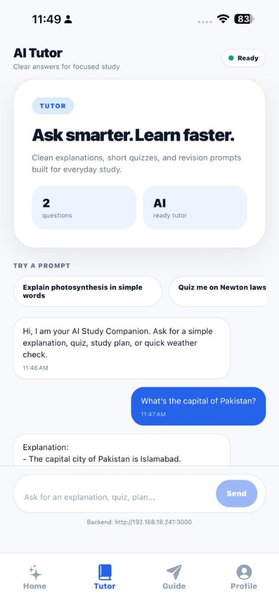
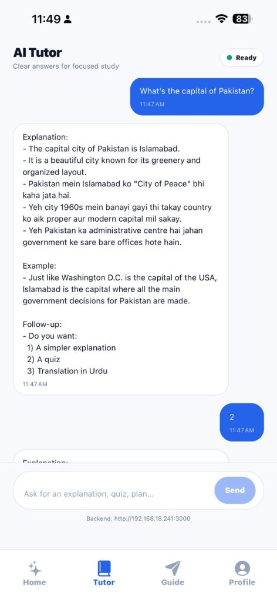

# AI Study Companion

AI Study Companion is an Expo app backed by an Express API. The app gives students short explanations, quiz prompts, study plans, and quick weather checks through a chat-first mobile interface.

## Screenshots

| Tutor overview | Quiz response | Follow-up flow |
| --- | --- | --- |
|  |  |  |

## Project Structure

- `app/`: Expo Router screens for the tutor and study guide tabs.
- `components/`, `hooks/`, `constants/`: shared UI, theme, and platform helpers.
- `ai-study-backend/`: Express server that talks to Groq (LLM) and Open-Meteo (weather).
- `api/`: Vercel serverless entry that serves the backend under `/api` on the web app's domain.

## Prerequisites

- Node.js 20 or newer is recommended.
- npm for dependency installation.
- A [Groq](https://console.groq.com/keys) API key for AI answers and quizzes.

## Backend Setup

1. Install backend dependencies:

   ```bash
   cd ai-study-backend
   npm install
   ```

2. Create a backend `.env` file:

   ```bash
   cp .env.example .env
   ```

3. Set `GROQ_API_KEY` in `ai-study-backend/.env`. Optionally override `GROQ_MODEL` (default: `openai/gpt-oss-120b`).

4. Start the API:

   ```bash
   npm run dev
   ```

The API runs on `http://localhost:3000` by default. Available routes:

- `GET /`: health check.
- `POST /ask`: study answers and weather questions.
- `POST /quiz`: three-question MCQ generation.

## App Setup

1. Install app dependencies:

   ```bash
   npm install
   ```

2. If you are testing on a physical phone, point the app at your machine's LAN address:

   ```bash
   EXPO_PUBLIC_API_BASE_URL=http://YOUR_LAN_IP:3000 npm start
   ```

   For web and iOS simulator, the app defaults to `http://localhost:3000`. For Android emulator, it defaults to `http://10.0.2.2:3000`.

3. For real Gmail sign-in, create OAuth client IDs in Google Cloud Console and add them to `.env`:

   ```bash
   cp .env.example .env
   ```

   ```bash
   EXPO_PUBLIC_GOOGLE_WEB_CLIENT_ID=your_google_web_client_id.apps.googleusercontent.com
   EXPO_PUBLIC_GOOGLE_IOS_CLIENT_ID=your_google_ios_client_id.apps.googleusercontent.com
   EXPO_PUBLIC_GOOGLE_ANDROID_CLIENT_ID=your_google_android_client_id.apps.googleusercontent.com
   ```

   Restart Expo after changing `EXPO_PUBLIC_*` values.

   Real Google sign-in uses `@react-native-google-signin/google-signin`, so it requires a development/native build. It will not run inside Expo Go. The current native identifiers are:

   - iOS bundle identifier: `com.aistudycompanion.app`
   - Android package: `com.aistudycompanion.app`
   - iOS URL scheme: `com.googleusercontent.apps.400215446002-6qvvqf4k07j99qokpqo11o64rb74ekrl`

4. Start Expo:

   ```bash
   npm start
   ```

## Quality Checks

Run the frontend linter:

```bash
npm run lint
```

Run a backend syntax smoke check:

```bash
cd ai-study-backend
npm run smoke
```

## Deploying to Vercel

The web app and the API deploy together as **one Vercel project** from the repository root. The native iOS/Android apps are not deployable to Vercel — use EAS Build for those.

1. Import the repository into Vercel and leave **Root Directory** as the repo root.
2. Under Project Settings → Environment Variables, add `GROQ_API_KEY` (and optionally `GROQ_MODEL`).
3. Deploy. `vercel.json` runs `npm run build:web` (`expo export -p web`), serves `dist/`, and routes `/api/*` to `api/index.js`, which mounts the Express app from `ai-study-backend/app.js`.

The deployed web build calls the API at `/api` on its own domain, so `EXPO_PUBLIC_API_BASE_URL` is not needed in production. If it is set to an `http://` URL (such as a LAN address), the https site ignores it, because browsers block those requests as mixed content.

The local `npm run dev` workflow is unchanged — `ai-study-backend/server.js` still calls `app.listen` on port 3000.

> **Rate limit caveat:** `express-rate-limit` uses in-memory state, which serverless functions cannot share across cold starts. The limiter still runs but the counters are unreliable. For production, swap the limiter store to Vercel KV or Upstash Redis.

For Google sign-in on the web build, set `EXPO_PUBLIC_GOOGLE_WEB_CLIENT_ID` in Vercel and add your Vercel domain (e.g. `https://your-app.vercel.app`) to the OAuth client's **Authorized JavaScript origins** in Google Cloud Console. Add `http://localhost:8081` as well for local testing. The web build signs in with Google Identity Services; iOS and Android use the native Google Sign-In module, which needs a development build.

## Notes

- Keep API keys in `ai-study-backend/.env`; do not expose them through `EXPO_PUBLIC_*` variables.
- The Expo app only needs the backend base URL. All Groq requests go through the Express server, so the API key never reaches the client.
- The legacy root-level `server.js` is not the production study API; use `ai-study-backend/server.js`.
